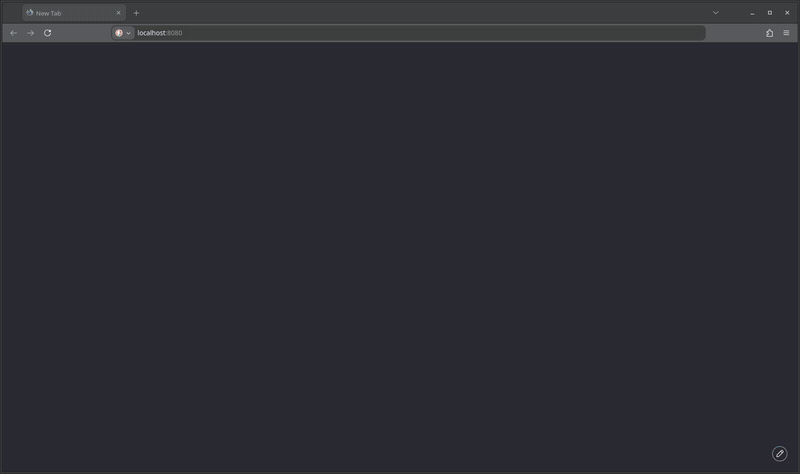

# CustomComplete
[](https://go.dev/)
[](LICENSE)
[](#configuration)

CustomComplete turns text into your own autocomplete engine. Upload, paste, or type text; it learns from it and suggests the next word or completes the one you're typing.
Go + SQLite, with a server-rendered Web-UI and a REST API.

> **v0.1:** The core pipeline is functional, expect rough edges.

## Features
- **Manage**: Create, patch, replace and delete texts
- **Process**: Background Worker builds up to 10-grams with live progress updates.
- **Suggest**:
  - Query ending mid-word → autocomplete
  - Query ending with whitespace/punctuation → next word

## Quick Start

### Prerequisites

- Go 1.26+
- Optional: CGo (see below)

### Run
```bash
git clone https://github.com/gitB3tter/CustomComplete
cd CustomComplete
go run ./cmd
```

you should see:
```
...
time=<timestamp> level=INFO msg="Server listening on :8080"
```

### Browser UI

Open http://localhost:8080 in your browser



### HTTP API Walkthrough

The API is hypertext-driven starting from `/`. Inspect `Link` headers or negotiate `application/linkset+json` to discover endpoints. JSON Schemas are linked via `rel="describedby"`. An OpenAPI Spec is linked from `/` via `rel="service-desc"`.

<details>
<summary>
1. Discover the texts collection
</summary>

```http
HEAD / HTTP/1.1
Host: localhost:8080
```
```http
HTTP/1.1 200 OK
Link: </texts>; rel="item"; type="text/html"
```
</details>


<details>
<summary>
2. Discover the request URL, content-type and request shape
</summary>

```http
HEAD /texts HTTP/1.1
Host: localhost:8080
```
```http
HTTP/1.1 200 OK
Accept-Post: multipart/form-data
Allow: GET, HEAD, POST, OPTIONS
Link: </texts/new>; rel="create-form"; title="Add Text"; type="text/html; charset=utf-8", </docs/specs/texts/collection>; rel="describedby"; type="application/vnd.oai.OpenAPI+json"; title="Documentation"
```
</details>

<details>
<summary>
3. Upload Text (Multipart)
</summary>

```http
POST /texts HTTP/1.1
Host: localhost:8080
Content-Type: multipart/form-data; boundary=----WebKitFormBoundaryXYZ
Prefer: return=minimal

----WebKitFormBoundaryXYZ
Content-Disposition: form-data; name="name"

Works of Shakespeare
----WebKitFormBoundaryXYZ
Content-Disposition: form-data; name="file"; filename="shakespeare.txt"
Content-Type: text/plain; charset=utf-8

The Complete Works of William Shakespeare

by William Shakespeare

...
```
```http
HTTP/1.1 201 Created
Location: /texts/1
Link: </texts/1/status>; rel="status"
Preference-Applied: return=minimal
```
</details>

<details>
<summary>
4. Observe Progress of Text Processing
</summary>

```http
GET /texts/1/status HTTP/1.1
Accept: text/event-stream
Host: localhost:8080
```
```http
HTTP/1.1 200 OK
Content-Type: text/event-stream

event: status
data: processing

event: progress
data: 2

event: stage
data: Counting words and phrases

...

event: progress
data: 100

event: status
data: completed

event: done
data: Processing complete
```
</details>

<details>
<summary>
5. Fetch Suggestions
</summary>

Query parameter `text`:
- Ends in whitespace/punctuation → next-word prediction
- Ends in word rune → prefix autocomplete

<details>
<summary>
Next-Word Prediction (`text="to be "` → `to%20be%20`)
</summary>

```http
GET /suggestions?text=to%20be%20 HTTP/1.1
Accept: application/linkset+json
Host: localhost:8080
```
```http
HTTP/1.1 200 OK
Content-Type: application/linkset+json

{
    "linkset": [
        {
            "item": [
                {
                    "href": "/suggestions?text=to+be+a+",
                    "title": "a"
                },
                {
                    "href": "/suggestions?text=to+be+so+",
                    "title": "so"
                }
            ]
        }
    ]
}
```
</details>

<details>
<summary>
Prefix Autocomplete (`text="to be or not to be t"`)
</summary>

```http
GET /suggestions?text=to%20be%20or%20not%20to%20be%20t HTTP/1.1
Accept: application/linkset+json
Host: localhost:8080
```
```http
HTTP/1.1 200 OK
Content-Type: application/linkset+json

{
    "linkset": [
        {
            "item": [
                {
                    "href": "/suggestions?text=to+be+or+not+to+be+that+",
                    "title": "that"
                },
                {
                    "href": "/suggestions?text=to+be+or+not+to+be+the+",
                    "title": "the"
                }
            ]
        }
    ]
}
```
</details>
</details>

*(examples truncated)*


## Design

- **Go & SQLite:** Built on the Go standard library. Uses any SQLite driver conforming to `database/sql` (configurable via build tags).

- **Content Negotiation:** Support for `text/html`, `application/json` and/or linksets (`application/linkset`, `application/linkset+json`)

- **HTTP Semantics:**
  - Conditional requests (`ETag` weak/strong, `If-None-Match` -> `304`, `If-Match` -> `412`/`428`)
  - partial metadata updates (`PATCH` `application/merge-patch+json`)
  - raw media replacement (`PUT`)
  - `Prefer` header support (`return=minimal/representation`, `handling=lenient/strict`)

- **Hypermedia:** Server-Driven Application State using established Web Linking Conventions and registered link relations.

- **Structured Errors:** Negotiated error responses across HTML error summaries, `application/problem+json` with validation extensions, and `text/plain`.

- **Progressive Enhancement:** Server-side rendered HTML working without JS (PRG), progressively enhanced with autonomous custom elements.

- **Async Worker Pipeline & Live Status:** Background n-gram processing with real-time progress via Server-Sent Events (`text/event-stream`) and JSON/HTML fallback polling.

- **Bilingual i18n:** Content-negotiated English and German responses (`Accept-Language` / `Content-Language`).

- **Self-documenting:** JSON Schemas and OpenAPI 3.1 served by the app itself.

## Configuration

### CLI Flags

```Bash
-addr=localhost:8080       # Bind address (default: :8080)
-workers=3                 # Number of background indexing workers (default: 2)
-db=my-filename.sqlite     # Path to SQLite database file (default: customcomplete.db)
-reset                     # Delete and recreate the database on startup
```

### SQLite Driver

Pure Go by default ([ncruces/go-sqlite3](https://github.com/ncruces/go-sqlite3))


| Driver | Build Tag | CGo | Ingestion Time |
|--------|-----|-----|----------------|
| ncruces (default) | — | no | ~2× |
| mattn | `-tags mattn` | yes | Baseline (1x) |
| modernc | `-tags modernc` | no | ~8× |